<div align="center">

<picture>
  <source media="(prefers-color-scheme: dark)" srcset="docs/readme/terra-logo-dark.svg">
  
</picture>

### See what your field is telling you.

NASA Earth observation and an in-field sensor station, combined into one living picture of one field:
what is changing, why, and which crop rotation to try next.


**Observe → Discover → Investigate → Understand → Experiment → Adapt**

</div>

---

## Contents

[The idea](#the-idea) · [A tour](#a-tour) · [Meet the station](#meet-the-station) · [Under the hood](#under-the-hood) ·
[Results on real NASA data](#results-on-real-nasa-data) · [Run it](#run-it) · [What is real](#what-is-real-and-what-is-not) ·
[Project map](#project-map) · [Team](#team) · [Use of AI](#use-of-ai-si)

## The idea

| | |
|---|---|
| **The problem** | NASA observes soil moisture, rain and vegetation every day, but as coarse grids and technical files that are hard to act on for one farm. A field sensor sees one spot, with no sense of what is normal. Rotations often follow habit. |
| **The solution** | One field, three kinds of evidence (satellites, an in-field station, simple stated models), each number labelled as a **field measurement**, **satellite estimate**, **model output** or **simulation**. |
| **The loop** | TERRA compares every new reading with the field's own history, flags what departs from it, shows the evidence and the next thing to check, and lets you test rotations against today's and tomorrow's climate before planting. |

<div align="center">

<br><sub>The project opens on a website with the logo assembling itself, then leads into the platform.</sub>
</div>

## A tour

<table>
<tr>
<td width="50%">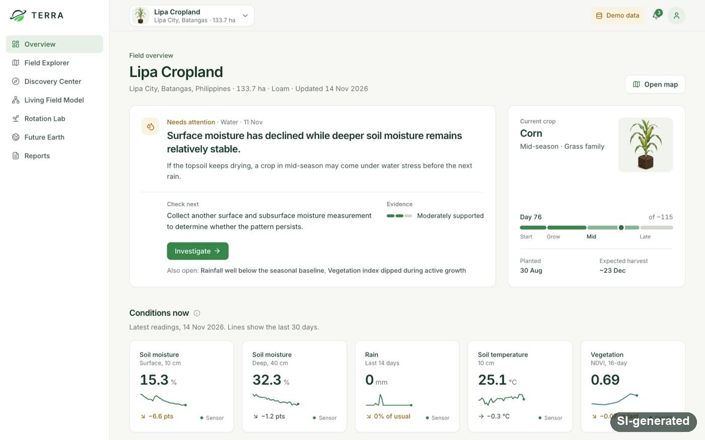<br><b>Overview</b><br><sub>What needs attention, the crop's stage, today's five key readings with their sources, trends, the station and recent activity.</sub></td>
<td width="50%">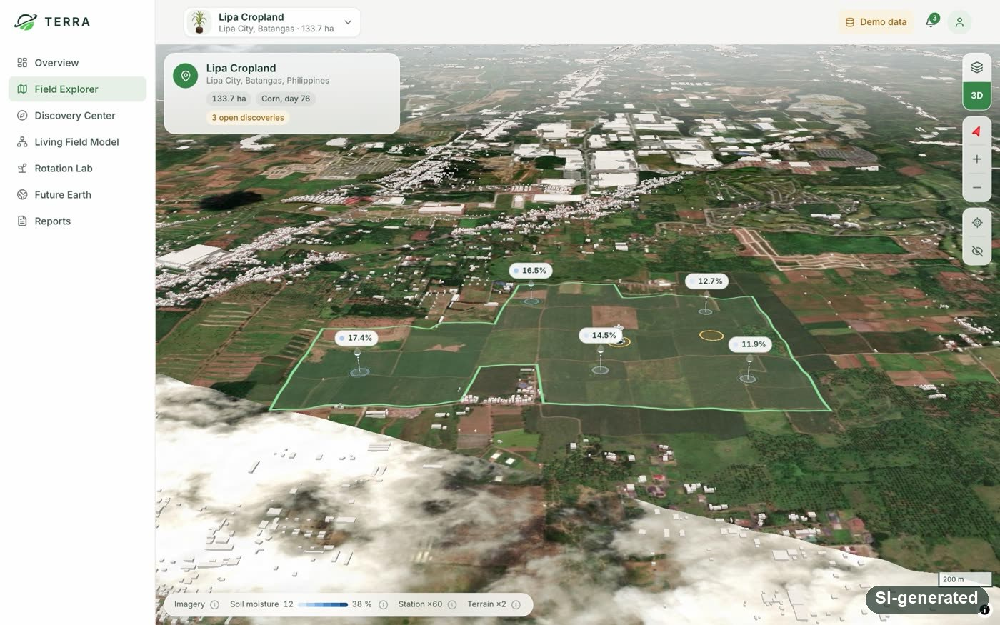<br><b>Field Explorer</b><br><sub>A maps-app style 3D view on real terrain: field boundary, station and soil-moisture beacons, NDVI columns. Press <kbd>H</kbd> to hide the controls.</sub></td>
</tr>
<tr>
<td>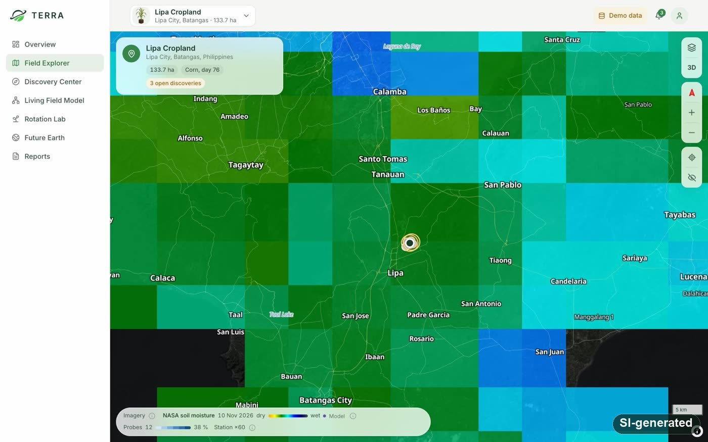<br><b>NASA moisture view</b><br><sub>Live NASA SMAP L4 surface soil moisture (9 km) from NASA GIBS, latest date looked up on load. A picture on the map; no values enter calculations.</sub></td>
<td>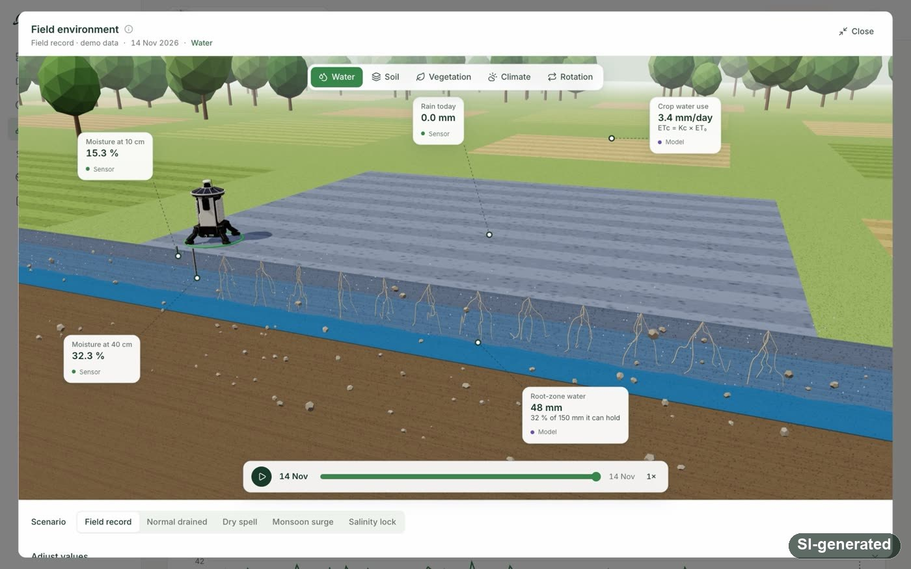<br><b>Living Field Model</b><br><sub>Water, soil, climate, vegetation and rotation as one picture, with an animated 3D field: soil fills with water, crops grow with the season, rain or sun follows the day.</sub></td>
</tr>
<tr>
<td>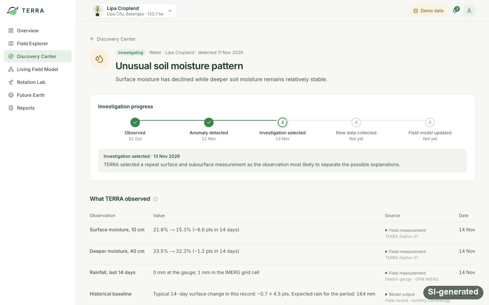<br><b>Discovery Center</b><br><sub>Unusual patterns flagged automatically, each with evidence charts, explanations marked unconfirmed, and the next observation to make.</sub></td>
<td>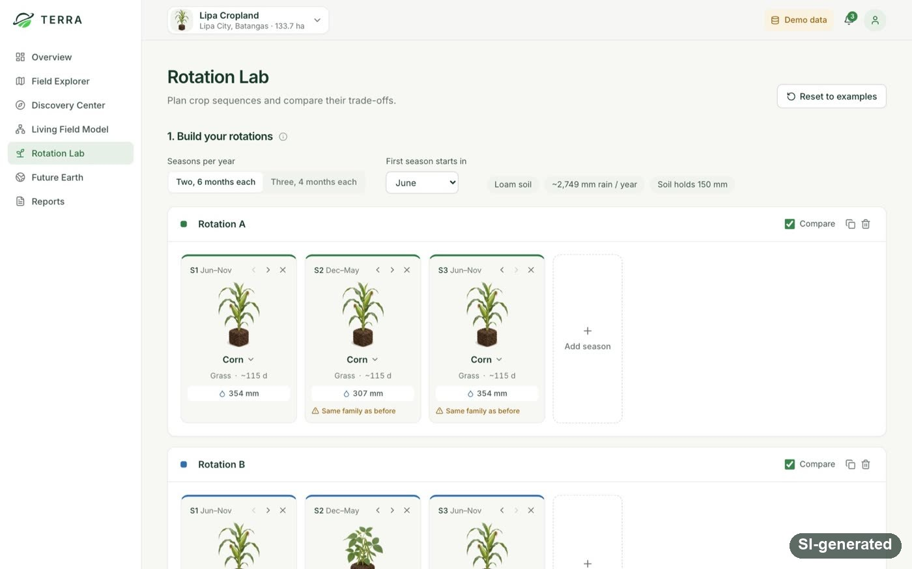<br><b>Rotation Lab</b><br><sub>Build crop sequences and compare them on water, diversity, soil cover, nutrients and heat. It never claims one rotation wins.</sub></td>
</tr>
<tr>
<td>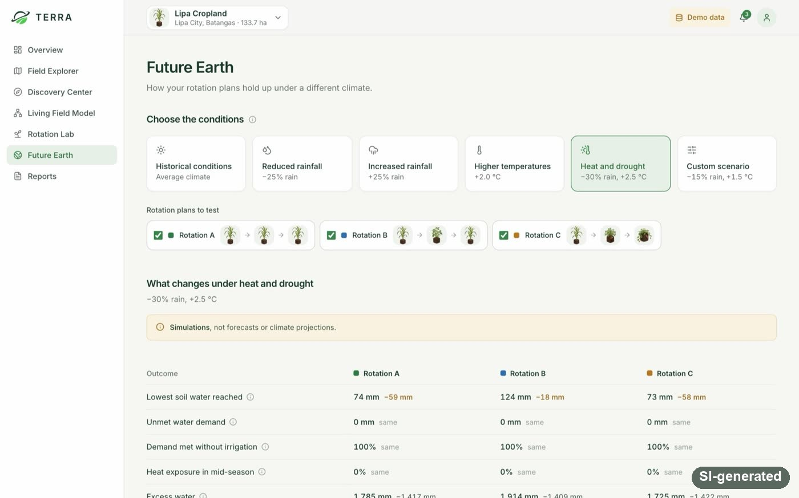<br><b>Future Earth</b><br><sub>Stress-test rotations under hotter, drier or wetter seasons. Labelled as simulations, not forecasts.</sub></td>
<td><b>Reports</b><br><sub>A printable Field Intelligence Report with sections you switch on or off, and a data-sources table that gives each NASA product's resolution and whether it is live, a snapshot or demo.</sub><br><br><b>Phones too</b><br><sub>The website and every page work at phone width; the map's controls stay within reach.</sub></td>
</tr>
</table>

<details>
<summary><b>More mockups</b></summary>
<br>
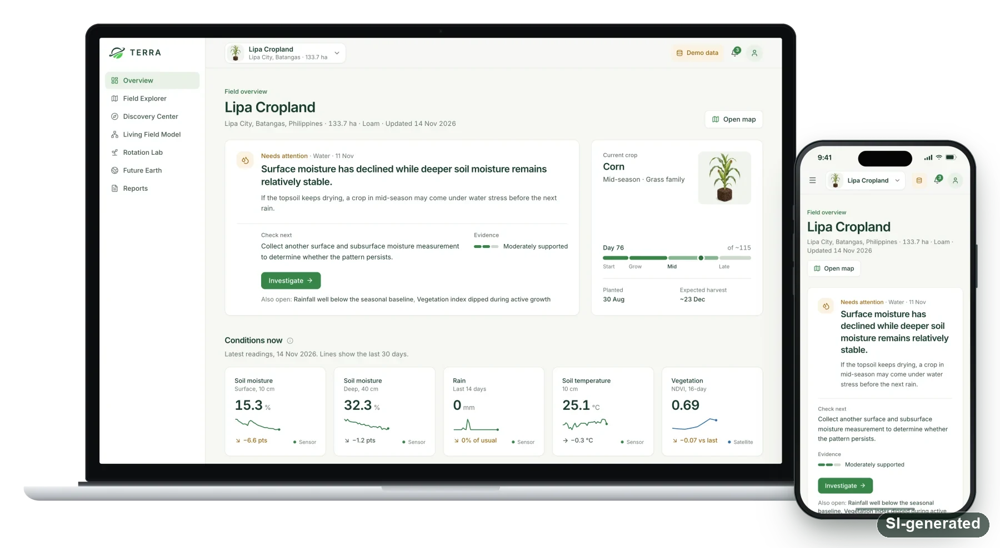
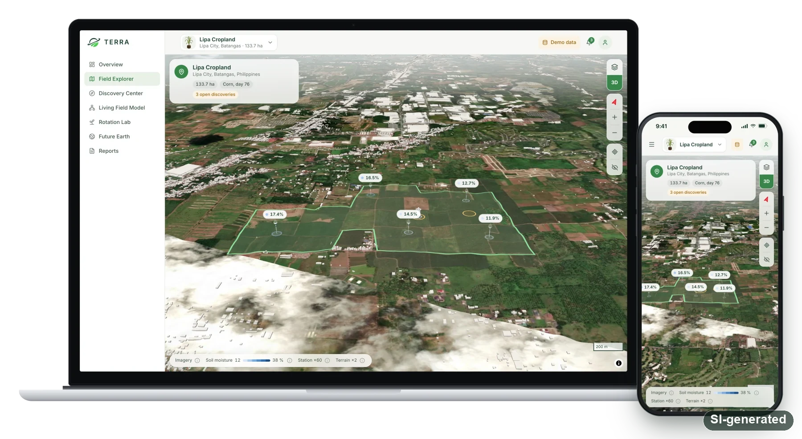
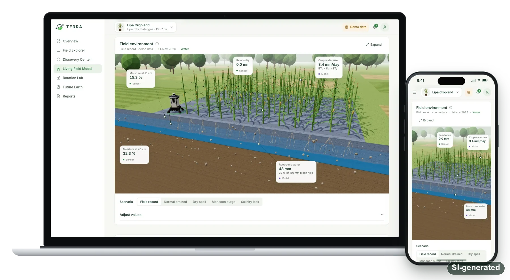
<sub>Full-resolution renders are in <code>docs/mockups/</code> and <code>docs/landing/</code>.</sub>
</details>

## Meet the station

<table>
<tr>
<td width="38%" align="center">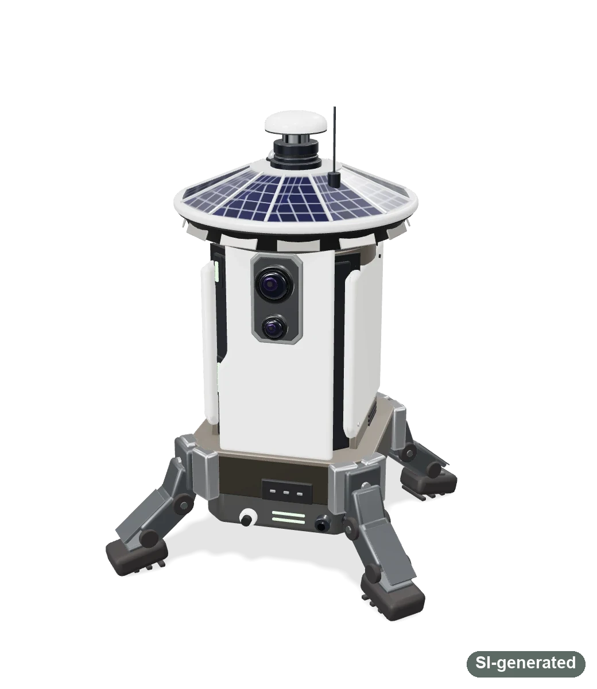</td>
<td width="62%" align="center">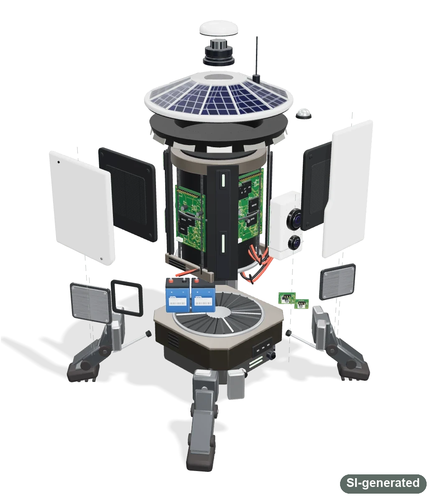</td>
</tr>
</table>

<div align="center">
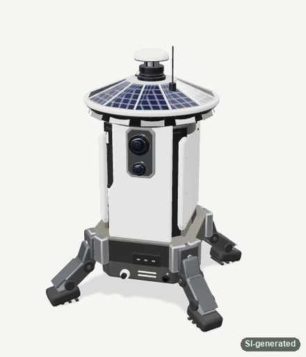
</div>

The **TERRA Autonomous Field Explorer** (TS-01) is a solar-powered pod that measures the soil where the crop
grows, so the satellites can be checked against the ground. It is shown in 3D on the website and the
Overview: drag to rotate, then press **Explode view** to pull it apart into its components.

| Module | Hardware |
|---|---|
| Soil moisture | FDR probes at 10, 30/40 and 60 cm |
| Soil temperature and EC | DS18B20 and a pore-water EC probe |
| Rainfall | Tipping bucket, 0.2 mm per tip |
| Light and micro-climate | BH1750 light sensor, SHT35 air temperature and humidity |
| Brains and radio | ESP32-S3 and STM32L476RG; LoRaWAN (SX1262) in the design |
| Power | 10 W solar, MPPT charger, LiFePO₄ pack |

<sub>Prototype design by the hardware team (<code>hardware/</code>): firmware, telemetry server, Blender model and WebGL simulator. No physical unit is installed; in the app, station readings are simulated and labelled as such. The viewer is <code>components/three/StationModel.tsx</code>; the exploded view and its procedural textures are <code>stationExplode.ts</code> and <code>stationTextures.ts</code>.</sub>

## Under the hood

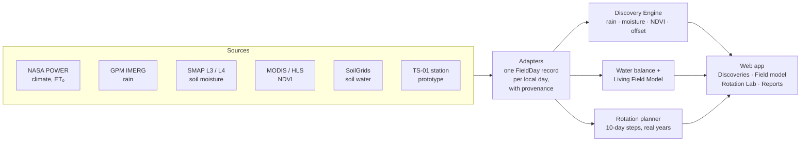

- **No look-ahead.** A detector only sees the days up to the day it judges, as it would running live.
- **Missing is missing.** A day without data is "unknown", never a guess or a zero. Nothing is interpolated.
- **One alarm per onset.** A pattern that lasts weeks is reported once, on the day it starts.
- **The science, stated.** Crop water need `ETc = Kc × ET₀` (FAO-56), root-zone water `TAW = (FC − WP) × root depth`,
  stress once water used exceeds `RAW = p × TAW`, rain departure `14-day rain ÷ expected rain`.
- **Simple first.** An inspectable rule or small model, until a simpler baseline is measured and shown to fall short.

## Results on real NASA data

The AI/ML workstream recalibrated its models on real NASA records for Lipa, Batangas, setting each threshold
from Lipa's own history instead of a guess. From its model report (15 November 2026):

| | Result |
|---|---|
| **48% → 18%** | Days flagged by the rain alarm in 2024–2025, old guessed limits against limits from 23 years of NASA POWER rain |
| **2 of 3** | Real 2024 events caught on time: Typhoon Carina and Storm Kristine; the El Niño drought was caught late (15 April) |
| **48 days** | Crop water stress in the 2024 dry season, agreeing with the farmer's report of drought in February–March 2024 |
| **10 of 24** | Years in which dry-season corn ran short of water, where the average-climate run showed no shortfall at all |

Three events show agreement, not an accuracy rate; no ground sensor exists yet to validate against. These
calibrated models are not yet merged into the web app, whose pages still show demo readings. Earlier synthetic
experiments (E-001 to E-004) and findings are in [`docs/ai-ml/`](docs/ai-ml/).

## Run it

```bash
npm install
npm run dev      # http://localhost:3000 opens the website; the platform starts at /overview
npm test         # Vitest unit tests
npm run lint
npm run build    # production build
```

Open a specific field with `?field=lipa-cropland`, `riverside` or `upland-c` on any page.
The synthetic Discovery Engine experiments run with `npm run experiment:discovery` and `npm run experiment:e002` to `e004`.

### The demonstration field

**Lipa Cropland** (Lipa City, Batangas, 133.7 ha) is the same ground in every part of the project: its boundary is
the pipeline's `Lipa_Cropland_AOI` polygon (`lipa_cropland_001`), and station `TS-01` is configured for a point
inside it. Two secondary demo fields (Riverside Plot in Isabela, Upland Block C in Bukidnon) keep their own
coordinates and records. No observation is ever shared between fields.

## What is real and what is not

| Data | Status |
|---|---|
| Lipa monthly climate (rain, ET₀, max temperature) | **Real.** NASA POWER climatology 2001–2025, retrieved 14 Nov 2026; ET₀ by FAO-56 Penman-Monteith. Drives the Rotation Lab and Future Earth for Lipa. |
| Lipa NASA record, 1–15 Jan 2024 (`data/nasa/`) | **Real.** POWER, GPM IMERG and SMAP values exported from the pipeline's `terra_daily_merged.json`. Shown in Living Field Model → Climate. Days without a SMAP overpass stay empty. |
| NASA moisture map in the Field Explorer | **Real, live.** NASA SMAP L4 surface soil moisture tiles from NASA GIBS. A model analysis that assimilates satellite data, 9 km cells; shown as a picture only. |
| Satellite base map | Real Esri World Imagery, labelled as an archive mosaic, not a current observation. |
| Daily station and satellite time series | **Demo.** Generated deterministically in `lib/demo/series.ts`, copying the sampling and scale of the real products. |
| Probe points, MODIS pixels, SMAP cell on the map | **Demo.** Generated in `lib/demo/spatial.ts`. |
| Climate of the two secondary fields | **Illustrative.** Written for the demo. |
| Rotation and scenario results | Real calculations (`lib/science/waterBalance.ts`) with indicative FAO-56 style crop parameters, not calibrated to a field. |
| Discoveries | Four fixed-threshold rules in `lib/science/detect.ts`; confidence shown as three plain levels, never a percentage. |

**Record audit.** Every observation series passes `lib/data/quality.ts` before a page sees it, whether it came from
the demo generator or a backend: rows sorted, duplicate dates removed, physically impossible values become gaps
(never zeros), extreme but valid events (rain ≥ 100 mm, air ≥ 40 °C) kept and flagged, nothing interpolated.
Dates are local calendar days at the field (`Field.timezone`).

## Project map

| Path | Contents |
|---|---|
| `app/` | Routes (`/` website, `/overview` and the platform pages), layout, `app/api/*` route handlers |
| `features/` | One folder per page: landing, overview, field-explorer, discovery, living-field-model, rotation-lab, future-earth, reports |
| `components/` | Brand (logo, loader), navigation shell, UI primitives, `charts/`, `maps/` (MapLibre, base styles, 3D beacons), `three/` (station, exploded view, field scene) |
| `services/` | The only layer the UI calls: fields, sensors, NASA data and GIBS, discoveries, rotations, scenarios, reports |
| `lib/science/` | Water balance, the four detectors, statistics, and the Discovery Engine v0.2.0 (`discovery/`) |
| `lib/demo/`, `lib/data/` | Demo generators; record audit and GIBS helpers |
| `data/` | Fields, crop parameters, scenarios, data-source catalogue, bundled NASA snapshot |
| `types/` | Shared domain types (the API contract) |
| `docs/` | NASA data pipeline, AI/ML notes and experiments, agronomic evaluation package, mockups and renders |
| `hardware/` | Station firmware, telemetry server, Blender model and 3D simulator |

### Connecting a backend

UI code only calls `services/`, which go through `services/apiClient.ts`. Set `NEXT_PUBLIC_API_BASE_URL`
(for example `http://localhost:8000`) and every call goes to that server instead of the mock layer:

```
GET  /api/fields                        GET  /api/fields/{id}/sources
GET  /api/fields/{id}/observations      GET  /api/fields/{id}/nasa-snapshot
GET  /api/fields/{id}/discoveries       POST /api/rotations/evaluate
GET  /api/fields/{id}/model             POST /api/scenarios/simulate
GET  /api/reports/{id}
```

Response shapes are the interfaces in `types/index.ts`. Two service calls have no local route yet
(`/api/scenarios`, `/api/fields/{id}/anomalies`). The NASA pipeline's FastAPI service does not serve this
contract yet; its `/observations/daily-merged` output is what `data/nasa/lipa-cropland-2024-01.json` came from.

### Design

Light-first. Tokens in `app/globals.css`: canvas `#F7F8F4`, ink `#183B2A`, green `#37864A`; Inter is the only
typeface. Charts use one component (`SeriesChart`): one axis and one unit per chart, green = field measurement,
blue = satellite, violet = model output. UI primitives in `components/ui` are hand-written in the shadcn style.
Plans, priorities, the selected field and logged follow-ups persist in `localStorage`; PDF export uses the
browser's print dialog.

## Team

| | |
|---|---|
| **Anjo** | Web application and website |
| **Vincent** | AI/ML: Discovery Engine, experiments and model calibration |
| **Kyle** | Agronomic evaluation package (`docs/Evaluation/`) |
| **Vince** | NASA Earth observation data pipeline (`docs/Data Pipeline/`) |
| **Luke** | Field station hardware, firmware and 3D models (`hardware/`) |

## Use of AI (SI)

Super Intelligence (SI) tools helped build TERRA. Every SI-generated image and video in this repository carries a
visible **SI-generated** watermark and a metadata note, and the 3D field environment and 3D station views in the app
are labelled "SI-generated" on screen. The full list, with paths, is in [`si-use.json`](si-use.json).

| Area | Tool | What |
|---|---|---|
| Web application and website | Claude Code (Anthropic) | Code written under the developer's direction and review: page layouts, 3D maps and beacons, the NASA GIBS moisture map, the 3D field environment, the station viewer and its exploded view, the website and loader, the guided tour |
| Field station hardware | SI tools | Hardware design, firmware and telemetry code, the 3D model, renders and the reveal video (watermarked) |
| Crop images | Figma AI | The crop renders used across the app (watermarked) |
| Mockups, renders and videos | Claude Code | Device mockups, website videos and README images, made by scripts from the running app (watermarked) |
| AI/ML models and experiments | Claude Code | Discovery Engine, synthetic experiments and notes, built with the project's Claude Code setup (`CLAUDE.md`, `.claude/`) |
| Promotional film | ElevenLabs, Claude Code, Blender | 30-second film in `docs/film/`: generated narration and sound effects, procedural Blender scenes, synthesised music (watermarked, labelled conceptual) |
| Documentation and copy | Claude Code | README, website and in-app text, tour text and the progress report, reviewed by the team |

Not SI: the TERRA logo, and the NASA data values themselves, which are retrieved from NASA services and never generated.
No NASA logos, flags or mission identifiers are used anywhere; "NASA" appears only as text naming the datasets.

<div align="center">
<br>
<picture>
  <source media="(prefers-color-scheme: dark)" srcset="docs/readme/terra-logo-dark.svg">
  
</picture>
<br>
<sub>Data: NASA POWER, GPM IMERG, SMAP, MODIS and GIBS · Imagery © Esri · Map data © OpenStreetMap contributors</sub>
</div>
