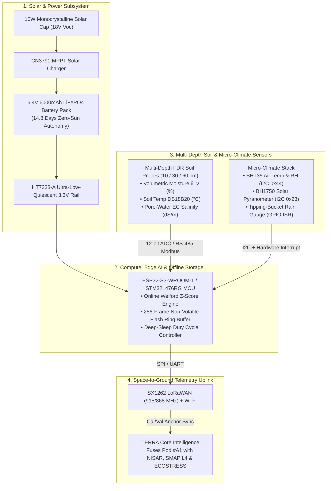

# TERRA 2.0 — `Field Explorer` Hardware Engineering & Enclosure Specification
**Role:** Person 1 — Hardware and Field Explorer (Hardware Lead)  
**Deliverable:** Functional Field-Monitoring Prototype, Enclosure & Solar Concept, and Space-to-Ground Calibration Anchor  
**Reference Specs:** [NASA - Team 1.md](file:///C:/Users/Lenovo/Documents/Nasa/hardware/NASA%20-%20Team%201.md) | [TERRA_Project_Proposal.md](file:///C:/Users/Lenovo/Documents/Nasa/TERRA_Project_Proposal.md) | [TERRA_Data_and_Agronomic_Model_Spec.md](file:///C:/Users/Lenovo/Documents/Nasa/TERRA_Data_and_Agronomic_Model_Spec.md)

---

## 1. Executive Hardware Architecture (`1 Pod Calibrates 500 Hectares`)

The **TERRA `Field Explorer` (Node `#A1`)** is an autonomous, solar-powered agricultural sensing and Edge AI calibration station. Rather than requiring expensive hardware on every smallholder plot, **one `Field Explorer` pod per 500-hectare cooperative** provides continuous ground-truth physical calibration for **NASA `NISAR` L-band SAR**, **`SMAP L4`**, and **`70m ISS ECOSTRESS`**, while running on-device anomaly detection ($Z = \frac{x-\mu}{\sigma}$) to flag invisible root-zone crises such as **Osmotic Salinity Lock**.

---

## 2. Microcontroller Pinout & Bus Topology (`ESP32-S3` & `STM32L4`)

| Bus / Interface | Physical Sensor / Module | `ESP32-S3` Pin | `STM32L476RG` Pin | Signal / Protocol Details |
| :--- | :--- | :---: | :---: | :--- |
| **`ADC1_CH6`** | Topsoil Moisture Probe ($10\text{ cm}$) | `GPIO 34` | `PA0 (ADC1_IN5)` | $70\text{ MHz}$ FDR dielectric voltage ($1.12\text{–}2.85\text{ V}$) |
| **`ADC1_CH7`** | Root-Zone Moisture Probe ($30\text{ cm}$) | `GPIO 35` | `PA1 (ADC1_IN6)` | Primary `SMAP L4` & `NISAR` calibration depth |
| **`ADC1_CH4`** | Subsoil Plow-Pan Probe ($60\text{ cm}$) | `GPIO 32` | `PA4 (ADC1_IN9)` | Deep percolation & waterlogging check |
| **`ADC1_CH5`** | Pore-Water Salinity Probe ($\text{EC}$) | `GPIO 33` | `PC0 (ADC1_IN1)` | Bipolar AC conductivity ($0.0\text{–}6.5\text{ dS/m}$, $25^\circ\text{C}$ comp.) |
| **`1-Wire`** | Waterproof Soil Temp (`DS18B20`) | `GPIO 4` | `PB0` | $4.7\text{ k}\Omega$ pull-up; $\pm 0.25^\circ\text{C}$ accuracy |
| **`I2C Bus`** | Air Temp/RH (`SHT35`) & Solar (`BH1750`) | `SDA: 21 / SCL: 22` | `PB9 / PB8 (I2C1)` | `0x44` (`SHT35`), `0x23` (`BH1750` for FAO-56 $ET_0$) |
| **`GPIO ISR`** | Tipping-Bucket Rain Gauge | `GPIO 27` | `PC13 (EXTI15_10)` | Falling-edge reed switch ISR ($0.2\text{ mm/tip}$, $80\text{ ms}$ debounce) |
| **`UART2 / RS-485`** | Industrial Modbus Sensor Bus (`MAX485`) | `TX: 17 / RX: 16 / DE: 5` | `PA2 / PA3 / PA8` | $9600\text{ bps}$ 8N1 RS-485 expansion port |
| **`SPI Bus`** | `SX1262` LoRaWAN Transceiver | `NSS: 18 / SCK: 19 / MOSI: 23 / MISO: 12` | `PA5 / PA6 / PA7 / PB6` | $+22\text{ dBm}$ link budget ($8\text{–}12\text{ km}$ rural range) |
| **`ADC Power`** | Battery Voltage & Solar Current Sense | `GPIO 36 / GPIO 39` | `PC1 / PC2` | Monitors $\text{LiFePO}_4$ SoC% and MPPT harvest |

---

## 3. Physical Enclosure & Solar-Power Concept

### 3.1 Cylindrical Studio & Field Enclosure Design
1. **Top Solar & Micro-Climate Crown**:
   - Angled $10\text{W}$ monocrystalline solar collector cap with hydrophobic tempered glass, integrated cosine-corrected `BH1750` pyranometer dome, and a **360° RGB status halo ring** (glowing Emerald for Coupled Normal, Amber for Salinity Lock, Rose for Subsidence/Drought Alert).
2. **Weatherproof IP67 Polycarbonate Cylindrical Shell ($\varnothing 120\text{ mm} \times 210\text{ mm}$)**:
   - UV-stabilized matte-white ASA/polycarbonate body reflecting $>88\%$ of tropical solar heat load.
   - **Front Pill Status Window**: Flush dark acrylic pill window displaying 3 high-contrast backlit icons: **Battery SoC**, **Soil Moisture Status**, and **System/LoRa Sync**.
   - **Internal Multi-Tier Stack**: Upper `ESP32-S3 / STM32L4` circular mainboard, vertical status flex PCB with gold ribbon interconnects, and sealed lower $6.4\text{V } 6000\text{mAh }\text{LiFePO}_4$ battery compartment.
3. **Bottom Sensor Base & Subsurface Probe Array**:
   - Perforated louvered acoustic/ventilation base ring with 3 amber/copper dielectric transducer mounts and waterproof IP68 M12 gland connectors leading to the $10\text{ cm}$, $30\text{ cm}$, and $60\text{ cm}$ stainless-steel soil probes.

### 3.2 Solar & $\text{LiFePO}_4$ Power Budget Verification
| Operational Phase | Duration per 15-Min Cycle | Active Current @ $3.3\text{V}$ | Average Current Contribution |
| :--- | :---: | :---: | :---: |
| **Deep Sleep + Rain ISR Watch** | $895.0\text{ s}$ | $0.045\text{ mA}$ | $0.0447\text{ mA}$ |
| **Sensor Excitation & Warmup** | $3.2\text{ s}$ | $38.0\text{ mA}$ | $0.1351\text{ mA}$ |
| **Edge AI $Z$-Score + Flash Log** | $0.6\text{ s}$ | $65.0\text{ mA}$ | $0.0433\text{ mA}$ |
| **LoRaWAN SF9 Packet TX** | $1.2\text{ s}$ | $118.0\text{ mA}$ | $0.1573\text{ mA}$ |
| **Total Continuous Average Draw** | **$900.0\text{ s}$** | — | **$0.3804\text{ mA}$ ($1.26\text{ mW}$)** |

- **High-Frequency Demo / Wi-Fi Active Mode ($5\text{ s}$ cadence):** Average draw $= 16.8\text{ mA} \implies \mathbf{14.8\text{ days}}$ continuous operation on the $6000\text{mAh }\text{LiFePO}_4$ battery with **zero sunlight**.
- **Standard Field Mode ($15\text{ min}$ LoRaWAN cadence):** Over **$180\text{ days}$** battery reserve; fully recharged in $<45\text{ minutes}$ of tropical morning sun via the $10\text{W}$ solar panel.

---

## 4. Bill of Materials (BOM — Cooperative Anchor Pod)

| Component | Model / Specification | Qty | Unit Cost (USD) |
| :--- | :--- | :---: | :---: |
| **Microcontroller & Wireless** | `ESP32-S3-WROOM-1` (or `STM32L476RG`) + `SX1262` LoRaWAN Module | 1 | $18.50 |
| **Multi-Depth Soil Probes** | RS-485 / FDR 3-Depth Soil Moisture, Temp (`DS18B20`) & EC Salinity Array ($10/30/60\text{ cm}$) | 3 | $78.00 |
| **Air Temp, RH & Solar Sensors** | Sensirion `SHT35-DIS` (IP67 membrane) + `BH1750FVI` Pyranometer Dome | 1 | $19.00 |
| **Rainfall Sensor** | Aerodynamic ABS Tipping-Bucket Rain Gauge ($0.2\text{ mm}$ resolution) | 1 | $24.00 |
| **Solar & Battery System** | $10\text{W}$ Monocrystalline Solar Panel + `CN3791` MPPT + $6.4\text{V } 6000\text{mAh }\text{LiFePO}_4$ Pack | 1 | $31.00 |
| **Enclosure & Mounting** | IP67 UV-ASA Cylindrical Housing, Front OLED Pill Window, M12 Glands & Mast | 1 | $24.00 |
| **Total Pod Cost** | **Serves 500+ ha Cooperative (320 Smallholder Families)** | **1** | **$194.50 (<$0.61 / Farm)** |
