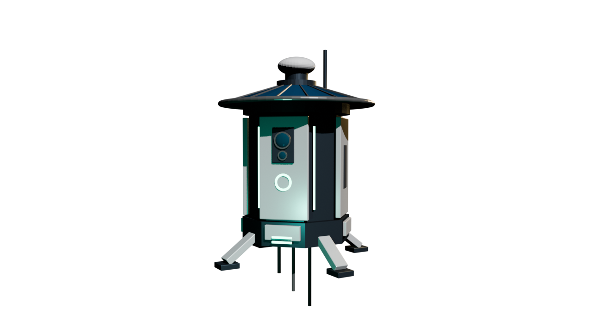
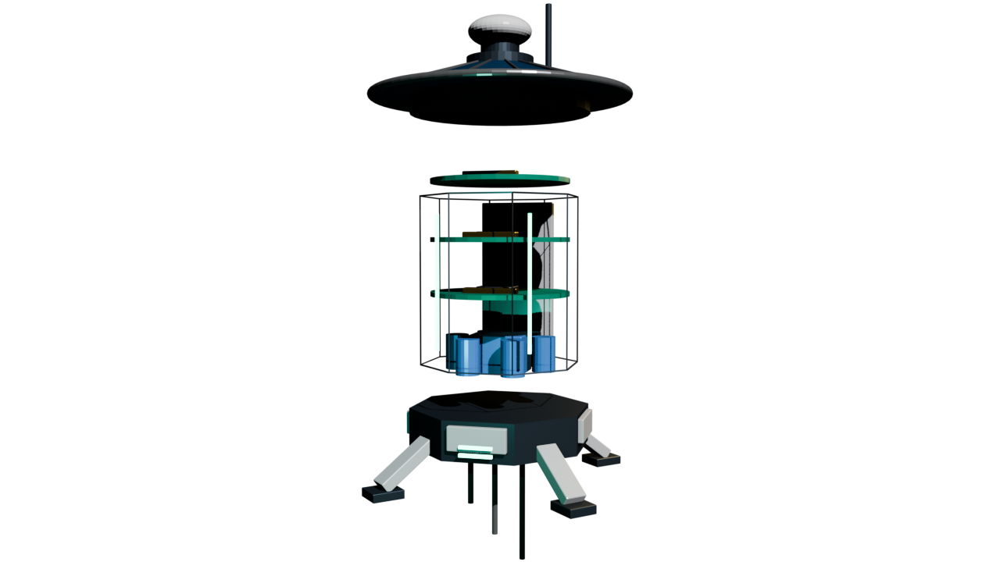
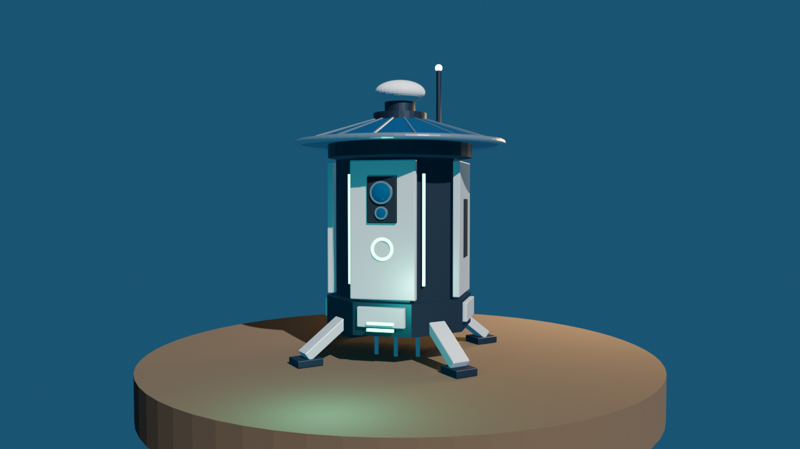
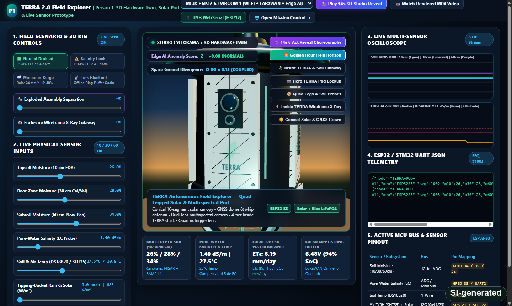

# TERRA Autonomous Field Explorer — Hardware, Firmware & 3D Twin (`hardware/`)

**Person 1 — Hardware & Field Explorer Lead**

This directory contains the complete hardware engineering deliverables, two-stage Blender 5.3 pipeline (**Stage 1: Isolated Standalone Device Alone** $\rightarrow$ **Stage 2: Full Environment Scene & Animation**), 3D product reveal video, and interactive WebGL 3D simulator for the **TERRA Autonomous Field Explorer (`TS-01` / `TERRA-POD-A1`)**, aligned with the `FerosC101/TERRA` TypeScript data contract (`FieldStation` and `DailyObservation` in `types/index.ts`).

---

## 1. Two-Stage 3D Blender Pipeline (`hardware/blender/`)

Per the two-stage 3D workflow:
1. **Stage 1 — Isolated Device Alone (`blender/generate_isolated_terra_device.py`)**:
   - Generates **only** the standalone TERRA hardware device centered at `(0, 0, 0)` with no environment backdrop and transparent film (`film_transparent = True`):
     - **[`blender/TERRA_Device_Isolated.blend`](./blender/TERRA_Device_Isolated.blend)** & **[`blender/TERRA_Device_Isolated.glb`](./blender/TERRA_Device_Isolated.glb)**
2. **Stage 2 — Full Scene & Animation (`blender/generate_terra_blender_scene.py`)**:
   - Loads `blender/TERRA_Device_Isolated.blend`, adds the field soil mound (`SM_TERRA_FieldSoil_Mound`), 3-point studio lighting, camera rig, and 5-act exploded animation timeline:
     - **[`blender/TERRA_Field_Explorer.blend`](./blender/TERRA_Field_Explorer.blend)** & **[`blender/TERRA_Field_Explorer.glb`](./blender/TERRA_Field_Explorer.glb)** (also mirrored at `./TERRA_Field_Explorer.blend` and `./TERRA_Field_Explorer.glb`)

### 🧩 Stage 1 Renders — Isolated Standalone TERRA Device Alone (`hardware/blender/`)
| Isolated Device — Exterior Armor (`TERRA_Device_Isolated_Render.png`) | Isolated Device — Inside TERRA 4-Tier Cutaway (`TERRA_Device_Isolated_Cutaway.png`) |
| :---: | :---: |
|  |  |

### 🎬 Stage 2 Renders — Full Studio Scene (`hardware/`)
| Frame 1 — Exterior Weatherproof Armor (`Blender_TERRA_Hero_Render.png`) | Frame 75 — Inside TERRA 4-Tier Cutaway (`Blender_TERRA_Inside_Cutaway.png`) |
| :---: | :---: |
|  |  |

---

## 2. 3D Product Reveal Video, Poster & Interactive WebGL Simulator

- **[▶️ Watch / Download `Field_Explorer_3D_Reveal.mp4`](./Field_Explorer_3D_Reveal.mp4)** — 14-second 3D product reveal (`1280x720 @ 30fps`) showcasing 360° camera orbit, exploded **Inside TERRA** 4-tier internal stack cutaway, and live Edge AI anomaly telemetry trigger.
- **[🌐 Launch Interactive 3D WebGL Simulator (`Field_Explorer_3D_Simulator.html`)](./Field_Explorer_3D_Simulator.html)** — Rotatable Three.js 3D hardware twin with **Explode View (Inside TERRA)** toggle and live sensor sliders.

### 🖼️ Official TERRA 3D Hardware Product Poster


### 🖥️ Interactive 3D WebGL Simulator & Live Telemetry Dashboard Preview


---

## 3. Directory Contents

| File / Folder | Description |
| :--- | :--- |
| `blender/TERRA_Device_Isolated.blend` & `blender/TERRA_Device_Isolated.glb` | **Stage 1 Standalone Isolated 3D TERRA Device** (`.blend` & `.glb` with zero environment clutter) |
| `blender/TERRA_Device_Isolated_Render.png` & `blender/TERRA_Device_Isolated_Cutaway.png` | **Stage 1 Transparent-Background Renders** of the isolated TERRA device alone (Closed & Cutaway) |
| `blender/generate_isolated_terra_device.py` | **Stage 1 Headless Blender 5.3 Script** that generates the isolated TERRA device alone |
| `blender/TERRA_Field_Explorer.blend` & `blender/TERRA_Field_Explorer.glb` | **Stage 2 Full Animated Blender 5.3 Scene & glTF 2.0 Asset** inside `blender/` (also mirrored in `hardware/`) |
| `blender/generate_terra_blender_scene.py` | **Stage 2 Headless Blender 5.3 Script** that loads `TERRA_Device_Isolated.blend` and builds the full scene |
| `Blender_TERRA_Hero_Render.png` & `Blender_TERRA_Inside_Cutaway.png` | **Stage 2 Full Scene Studio Renders** (Frame 1 Closed Armor + Frame 75 Inside TERRA 4-Tier Cutaway) |
| `Field_Explorer_3D_Reveal.mp4` | **14-Second 3D Product Reveal Video (`1280x720 @ 30fps`, H.264 MP4)** |
| `Field_Explorer_3D_Simulator.html` | **Interactive Three.js WebGL 3D Hardware Twin & Live Telemetry Dashboard** |
| `Field_Explorer_Product_Poster.png` | **Official TERRA 3D Hardware Product Showcase Poster (`1600x1060`)** |
| `Field_Explorer_Simulator_Preview.png` | **3D WebGL Simulator & Dashboard Preview Render** |
| `firmware/field_explorer_esp32/field_explorer_esp32.ino` | **ESP32-S3 / STM32 Arduino Firmware** (`v2.1.0`) implementing all 6 TERRA sensor modules, on-device Welford Z-score Edge AI anomaly detection, and 256-frame offline ring buffer |
| `firmware/field_explorer_esp32/platformio.ini` | **PlatformIO Build Configuration** for `esp32-s3-devkitc-1` and `nucleo_l476rg` |
| `backend/telemetry_server.py` & `backend/test_telemetry.py` | **Python Telemetry & Space-to-Ground Calibration Server** + automated unit test suite (`6/6 OK`) |
| `backend/render_webgl_3d_video.py` | **Automated Headless WebGL 3D Video & Poster Rendering Pipeline** |
| `HARDWARE_ENGINEERING_SPEC.md` | **Hardware Engineering Specification** |

---

## 4. 6-Module Sensor Suite & `FerosC101/TERRA` Schema Alignment

| TERRA Sensor Module | Hardware Interface | Firmware Field (`sensors.*`) | `FerosC101/TERRA` `DailyObservation` Field |
| :--- | :--- | :--- | :--- |
| **1. Soil Moisture** | FDR Probes (`10 cm`, `30/40 cm`, `60 cm`) on `GPIO 34, 35, 32` | `moisture_10cm`, `moisture_40cm`, `storage_mm` | `surfaceVwc`, `deepVwc`, `storageMm` |
| **2. Soil Temperature & Bulk EC** | `DS18B20` 1-Wire (`GPIO 4`) + Pore-Water EC (`GPIO 33`) | `soil_temp_c`, `soil_ec_dsm` | `soilTempC`, `ecDsM` |
| **3. Rainfall** | Tipping-bucket reed switch ISR (`GPIO 27`, `0.2 mm/tip`) | `rain_mm`, `rain_mm_hr` | `rainMm` |
| **4. Vegetation Index** | Multispectral Crop Health / Optical NDVI (`GPIO 25` / I2C) | `ndvi` (`0.00–1.00`) | `ndvi` |
| **5. Solar Radiation & Micro-Climate** | `BH1750` Pyranometer + `SHT35` Air Temp/RH (`I2C 21/22`) | `solar_wm2`, `air_temp_c`, `et0_mm_day` | `tmaxC`, `et0Mm` |
| **6. Location (GNSS Auto-Sync)** | Multi-constellation GNSS receiver + UTC sync | `gnss.lat`, `gnss.lng`, `gnss.fix` | `FieldStation.position` (`TS-01`: `13.9847, 121.1858`, inside the Lipa Cropland boundary) |

---

## 5. Quickstart & Verification

```powershell
# Step 1: Generate Isolated TERRA Device Alone (.blend, .glb, & transparent renders in blender/)
& "C:\Program Files\Blender Foundation\Blender 5.3\blender.exe" -b -P blender/generate_isolated_terra_device.py

# Step 2: Generate Full Scene & Studio Renders from the Isolated Device
& "C:\Program Files\Blender Foundation\Blender 5.3\blender.exe" -b -P blender/generate_terra_blender_scene.py

# Run Telemetry Unit Tests
python -B -m unittest discover -s backend -p "test_*.py" -v
```
