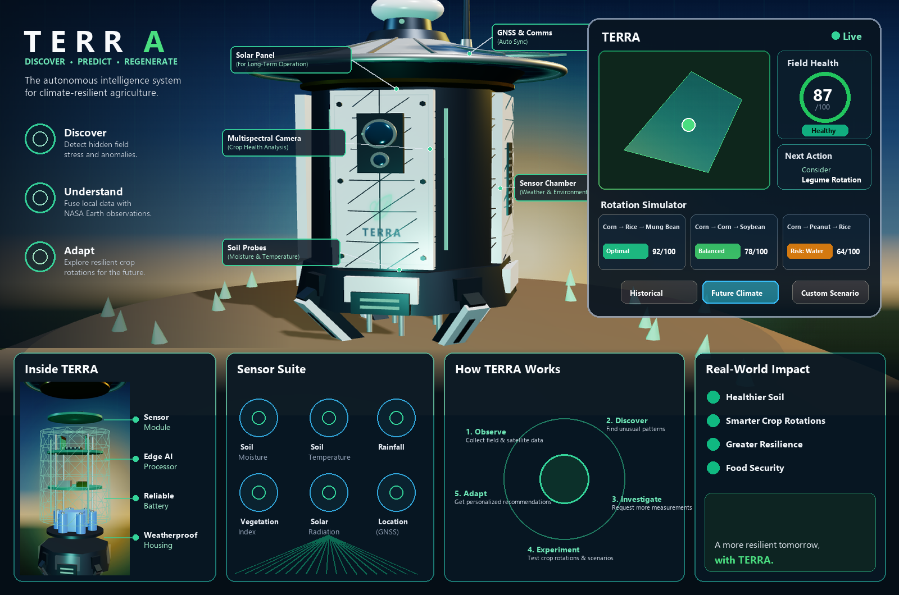
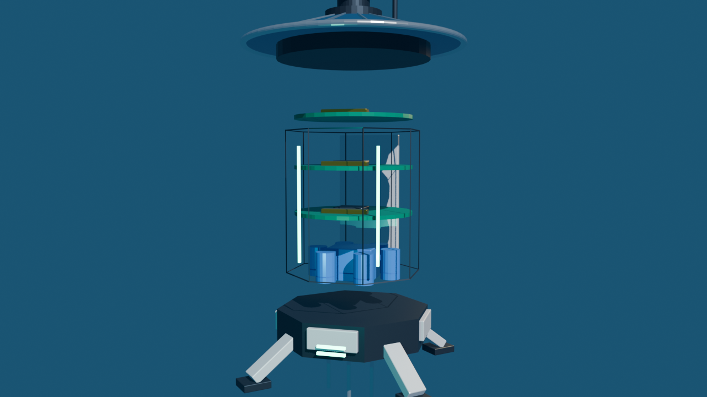

# TERRA Autonomous Field Explorer — Hardware, Firmware & 3D Twin (`hardware/`)

**Person 1 — Hardware & Field Explorer Lead**

This directory contains the complete hardware engineering deliverables, 3D product reveal video, interactive WebGL 3D simulator, and native Blender 5.3 assets for the **TERRA Autonomous Field Explorer (`TS-01` / `TERRA-POD-A1`)**, aligned with the `FerosC101/TERRA` TypeScript data contract (`FieldStation` and `DailyObservation` in `types/index.ts`).

---

## 1. 3D Product Reveal Video & Visual Showcase

### 🎬 3D Product Reveal Video (`1280x720 @ 30fps`)
- **[▶️ Watch / Download `Field_Explorer_3D_Reveal.mp4`](./Field_Explorer_3D_Reveal.mp4)** — 14-second 3D product reveal showcasing 360° camera orbit, exploded **Inside TERRA** 4-tier internal stack cutaway, and live Edge AI anomaly telemetry trigger.
- **[🌐 Launch Interactive 3D WebGL Simulator (`Field_Explorer_3D_Simulator.html`)](./Field_Explorer_3D_Simulator.html)** — Rotatable Three.js 3D hardware twin with **Explode View (Inside TERRA)** toggle and live sensor sliders.
- **[🧊 Download Blender 5.3 Scene (`TERRA_Field_Explorer.blend`)](./TERRA_Field_Explorer.blend)** | **[📦 Download 3D glTF Asset (`TERRA_Field_Explorer.glb`)](./TERRA_Field_Explorer.glb)**

### 🖼️ Official TERRA 3D Hardware Product Poster


### 🧊 Native Blender 5.3 Studio Renders (Exterior Armor & Inside TERRA 4-Tier Cutaway)
| Frame 1 — Exterior Weatherproof Armor (`Blender_TERRA_Hero_Render.png`) | Frame 75 — Inside TERRA 4-Tier Cutaway (`Blender_TERRA_Inside_Cutaway.png`) |
| :---: | :---: |
|  |  |

### 🖥️ Interactive 3D WebGL Simulator & Live Telemetry Dashboard Preview


---

## 2. Directory Contents

| File / Folder | Description |
| :--- | :--- |
| `Field_Explorer_3D_Reveal.mp4` | **14-Second 3D Product Reveal Video (`1280x720 @ 30fps`, H.264 MP4)** showcasing 360° orbit, exploded internal 4-tier architecture cutaway, and live salinity/anomaly telemetry trigger |
| `Field_Explorer_3D_Simulator.html` | **Interactive Three.js WebGL 3D Hardware Twin & Live Telemetry Dashboard** with Inside TERRA exploded cutaway mode, live sliders, and NASA orbital vs. ground calibration charts |
| `Field_Explorer_Product_Poster.png` | **Official TERRA 3D Hardware Product Showcase Poster (`1600x1060`)** |
| `Field_Explorer_Simulator_Preview.png` | **3D WebGL Simulator & Dashboard Preview Render** |
| `TERRA_Field_Explorer.blend` & `TERRA_Field_Explorer.glb` | **Native Blender 5.3 Scene & glTF 2.0 3D Asset** with hierarchical collections (`COL_TERRA_Exterior`, `COL_TERRA_InsideCutaway`, `COL_TERRA_Probes`, `COL_TERRA_Environment`, `COL_TERRA_StudioLighting`) |
| `Blender_TERRA_Hero_Render.png` & `Blender_TERRA_Inside_Cutaway.png` | **Native Blender 5.3 Studio Renders** (Frame 1 Closed Armor + Frame 75 Inside TERRA 4-Tier Cutaway) |
| `blender/generate_terra_blender_scene.py` | **Headless Blender 5.3 Procedural Scene Builder Script** |
| `firmware/field_explorer_esp32/field_explorer_esp32.ino` | **ESP32-S3 / STM32 Arduino Firmware** (`v2.1.0`) implementing all 6 TERRA sensor modules, on-device Welford Z-score Edge AI anomaly detection, 256-frame offline circular ring buffer, and dual Serial + Wi-Fi HTTP JSON telemetry |
| `firmware/field_explorer_esp32/platformio.ini` | **PlatformIO Build Configuration** for `esp32-s3-devkitc-1` and `nucleo_l476rg` |
| `backend/telemetry_server.py` & `backend/test_telemetry.py` | **Python Telemetry & Space-to-Ground Calibration Server** + automated unit test suite |
| `backend/render_webgl_3d_video.py` | **Automated Headless WebGL 3D Video & Poster Rendering Pipeline** |
| `HARDWARE_ENGINEERING_SPEC.md` | **Hardware Engineering Specification** (BOM, GPIO pinout, 6.4V LiFePO4 + 10W Solar power budget, and enclosure architecture) |

---

## 3. 6-Module Sensor Suite & `FerosC101/TERRA` Schema Alignment

| TERRA Sensor Module | Hardware Interface | Firmware Field (`sensors.*`) | `FerosC101/TERRA` `DailyObservation` Field |
| :--- | :--- | :--- | :--- |
| **1. Soil Moisture** | FDR Probes (`10 cm`, `30/40 cm`, `60 cm`) on `GPIO 34, 35, 32` | `moisture_10cm`, `moisture_40cm`, `storage_mm` | `surfaceVwc`, `deepVwc`, `storageMm` |
| **2. Soil Temperature & Bulk EC** | `DS18B20` 1-Wire (`GPIO 4`) + Pore-Water EC (`GPIO 33`) | `soil_temp_c`, `soil_ec_dsm` | `soilTempC`, `ecDsM` |
| **3. Rainfall** | Tipping-bucket reed switch ISR (`GPIO 27`, `0.2 mm/tip`) | `rain_mm`, `rain_mm_hr` | `rainMm` |
| **4. Vegetation Index** | Multispectral Crop Health / Optical NDVI (`GPIO 25` / I2C) | `ndvi` (`0.00–1.00`) | `ndvi` |
| **5. Solar Radiation & Micro-Climate** | `BH1750` Pyranometer + `SHT35` Air Temp/RH (`I2C 21/22`) | `solar_wm2`, `air_temp_c`, `et0_mm_day` | `tmaxC`, `et0Mm` |
| **6. Location (GNSS Auto-Sync)** | Multi-constellation GNSS receiver + UTC sync | `gnss.lat`, `gnss.lng`, `gnss.fix` | `FieldStation.position` (`TS-01`: `16.8731, 121.5846`) |

---

## 4. Quickstart & Verification

### Run Telemetry Unit Tests
```powershell
python -B -m unittest discover -s backend -p "test_*.py" -v
```

### Start Live Telemetry Server
```powershell
python -B backend/telemetry_server.py
```

### Launch Interactive 3D Hardware Simulator
Open `Field_Explorer_3D_Simulator.html` in any modern browser to orbit the 3D TERRA pod, toggle **Explode View (Inside TERRA)**, and simulate live sensor anomalies.

### Rebuild Native Blender 5.3 Scene & Renders Headlessly
```powershell
& "C:\Program Files\Blender Foundation\Blender 5.3\blender.exe" -b -P blender/generate_terra_blender_scene.py
```
